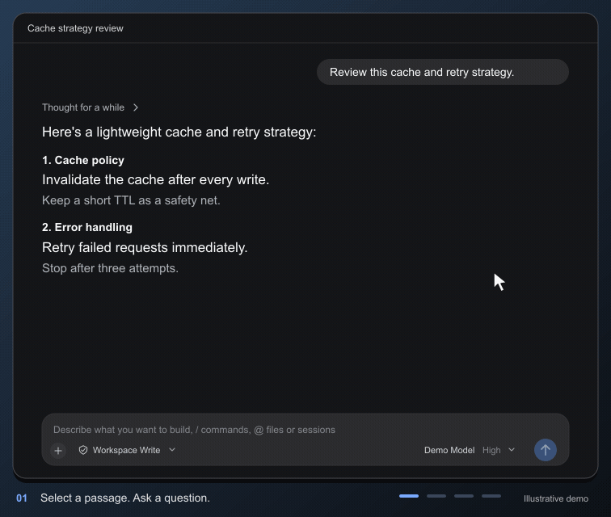

# In-place Annotate for DSH

**English** | [简体中文](README.zh-CN.md)

In the DSH Web chat, select a sentence in an agent reply and mark it inplace with **Agree**, **Disagree**, **Question**, or **Comment**. Annotations are held in the current conversation and attached automatically when you send your next prompt.

- Made for reviewing long replies: annotate as you read, then give all your feedback at once.
- Every annotation carries the sentence you selected, so the agent knows exactly which part you mean.
- Annotated passages get a highlighter-style mark in the reply. Click an entry in the pending list to jump back to it.

## Contents

- [In-place Annotate for DSH](#in-place-annotate-for-dsh)
  - [Contents](#contents)
  - [Prerequisites](#prerequisites)
  - [Installation](#installation)
  - [Quick Start](#quick-start)
  - [Using Annotations](#using-annotations)
  - [Uninstalling](#uninstalling)
  - [License](#license)

## Prerequisites

- The DSH **Web GUI** (the page opened by `dsh web`). The plugin's UI is Web-only.
- The plugin installed and enabled in your current profile (package name `@local/dsh-inplace-annotate`).
- A browser that can reach your DSH page, with your session still signed in.

## Installation

This plugin is a local bundle installed through DSH's Plugin Manager. It appears there as **Reply annotations** (or **回复批注**, depending on the UI language; package name `@local/dsh-inplace-annotate`).

For a first-time install:

1. Install this plugin directory as a local bundle through DSH's Plugin Manager. If you are working with a DSH agent, ask it to run **Install bundle** against this directory.
2. Confirm that `@local/dsh-inplace-annotate` appears in the plugin list and is enabled.
3. **Refresh the current DSH page.** Client code is injected at page load, so installing without refreshing will not show the new UI.
4. If Plugin Manager says a restart is required, restart that profile as prompted, then reopen the page.

If you change plugin code, reload the plugin and refresh the page. Editing files alone does not replace client code that is already loaded.

## Quick Start

1. Wait for an agent reply to **finish** (streaming complete).
2. Select a sentence or a phrase in the reply with your mouse.
3. A toolbar appears above the selection: **Agree / Disagree / Question / Comment / Quote**.
4. Clicking **Agree**, **Disagree**, or **Question** records it immediately. Clicking **Comment** opens an input box; write your note and press `Cmd/Ctrl+Enter` to save. The passage is then highlighted.
5. A pending annotations bar (labeled **Review notes** in the UI) appears above the input box, listing the annotations you have accumulated. Click an entry's text area or its right-hand arrow to jump back to the corresponding passage.
6. Type and send your next prompt as usual. Annotations go to the agent with that prompt; your own bubble shows only the text you typed.
7. Once the agent picks up the next prompt, the pending annotations bar clears itself.

## Using Annotations

| Action | What it does | After saving |
|---|---|---|
| **Agree** | You endorse the selected text | Records the selected text; no change requested from the agent |
| **Disagree** | You reject the selected text | Records the selected text; the agent should revise or reconsider it |
| **Question** | You are unsure about the selected text and want the agent to explain it further | Records the selected text immediately; no note is required |
| **Comment** | Enter specific feedback | Records the selected text plus your note; the note can be edited later |
| **Quote** | Insert the selected text into the input box (the existing quote feature in DSH) | No annotation; the text only goes into the input box |
| **Jump** | Click an entry in the pending annotation bar | Scrolls to the selected annotation and briefly highlights it |

## Uninstalling

1. Disable or remove `@local/dsh-inplace-annotate` in Plugin Manager.
2. Refresh the DSH page.
3. On uninstall, the Host cleans up annotations that are still pending; annotations already sent remain as conversation history.

To turn it off temporarily, set the `inplace-annotate` line in the profile's `cordis.patch.yml` to `disabled: true`.

## License

Released under the [MIT License](LICENSE).
