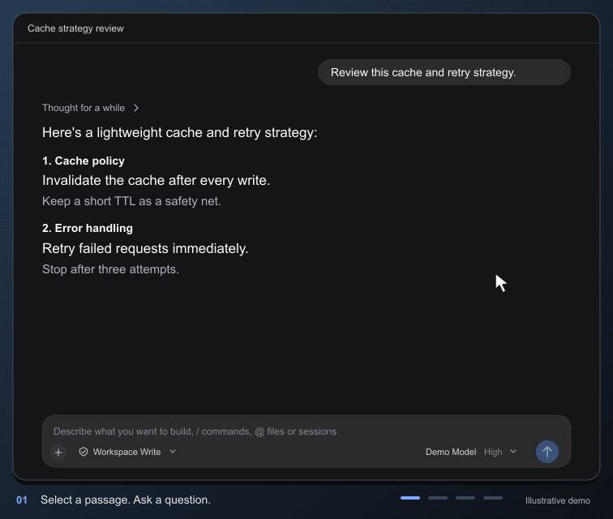

# dsh-inplace-annotate

**English** | [简体中文](README.zh-CN.md)

In the DSH Web chat, select a passage in an agent reply and mark it **Agree**, **Disagree**, **Question**, or **Comment**. Annotations are held in the current conversation and attached automatically when you send your next message. The message you send stays clean: annotation text never shows up in the chat transcript.

- Made for reviewing long replies: annotate as you read, then give all your feedback at once.
- Every annotation carries the passage you selected, so the agent knows exactly which part you mean.
- Annotated passages get a highlighter-style mark and a corner badge in the reply. Click an entry in the pending list to jump back to it.
- Scoped to the current conversation. Uninstall the plugin and the built-in **Quote text** button returns.

## Preview



*Illustrative demo focused on the annotation workflow. Conversation content and model names are fictional examples.*

---

## Contents

- [Requirements](#requirements)
- [Installation](#installation)
- [Quick start](#quick-start)
- [Using annotations](#using-annotations)
- [Pending annotations bar](#pending-annotations-bar)
- [How annotations reach the agent](#how-annotations-reach-the-agent)
- [Troubleshooting](#troubleshooting)
- [Uninstalling](#uninstalling)
- [Developer checks](#developer-checks)
- [License](#license)

---

## Requirements

- The DSH **Web GUI** (the page opened by `dsh web`). The plugin's UI is Web-only.
- The plugin installed and enabled in your current profile (package name `@local/dsh-inplace-annotate`).
- A browser that can reach your DSH page, with your session still signed in.

> Annotations reach the local Host through DSH's existing browser session. No extra tokens or API keys are needed.

## Installation

This plugin is a local bundle installed through DSH's Plugin Manager. It appears there as **Reply annotations** (or **回复批注**, depending on the UI language; package name `@local/dsh-inplace-annotate`).

For a first-time install:

1. Install this plugin directory as a local bundle through DSH's Plugin Manager. If you are working with a DSH agent, ask it to run **Install bundle** against this directory.
2. Confirm that `@local/dsh-inplace-annotate` appears in the plugin list and is enabled.
3. **Refresh the current DSH page.** Client code is injected at page load, so installing without refreshing will not show the new UI.
4. If Plugin Manager says a restart is required, restart that profile as prompted, then reopen the page.

After changing plugin code, reload the plugin and refresh the page. Editing files alone does not replace client code that is already loaded.

## Quick start

1. Wait for an agent reply to **finish** (streaming complete).
2. Select a passage in the reply with your mouse.
3. A toolbar appears above the selection: **Agree / Disagree / Question / Comment / Quote**.
4. Clicking **Agree**, **Disagree**, or **Question** records it immediately. Clicking **Comment** opens an input box; write your note and press `Cmd/Ctrl+Enter` to save. The passage is then highlighted and gets a corner badge.
5. A pending annotations bar (labeled **Review notes** in the UI) appears above the input box, listing the annotations you have accumulated. Click an entry's text area or its right-hand arrow to jump back to the corresponding passage.
6. Type and send your next message as usual. Annotations go to the agent with that message; your own bubble shows only the text you typed.
7. Once the agent picks up the message, the pending annotations bar clears itself within about 1.5 seconds.

A typical flow:

> - Select "this approach introduces an extra network request" → **Disagree**
> - Select "the cache is invalidated after every write" → **Question**
> - Select "error-handling suggestion" → **Comment**: "Please give a concrete retry strategy with backoff timings"
> - Send: "Address the feedback and questions above"

## Using annotations

| Action | What it does | After saving |
|---|---|---|
| **Agree** | You endorse the selected text | Records the passage; no change requested from the agent |
| **Disagree** | You reject the selected text | Records the passage; the agent should revise or reconsider it |
| **Question** | You are unsure about the selected text and want the agent to explain it further | Records the passage immediately; no note is required |
| **Comment** | Enter specific feedback | Records the passage plus your note; the note can be edited later |
| **Quote** | Insert the selected text into the input box (the existing quote feature) | No annotation; the text only goes into the input box |
| **Highlight** | Saved passages get a yellow highlighter background and a category-colored underline | A corner badge shows Agree / Disagree / Question / Comment |
| **Jump** | Click an entry's text area or its right-hand arrow | Scrolls to the passage and briefly highlights it |

- Highlights share one yellow highlighter background. The underline and corner badge are colored by category: green for Agree, red for Disagree, amber for Question, and blue for Comment.
- Both the entry's text area and its right-hand arrow jump to the passage. The entry flashes briefly when the jump succeeds.
- In the **Comment** input box, `Cmd/Ctrl+Enter` saves and `Esc` cancels back to the toolbar.
- All buttons work with the keyboard: Tab to focus, Enter or Space to activate.
- The toolbar replaces the built-in **Quote text** mini-button. Quoting still works; it is now part of the same toolbar.

## Pending annotations bar

The bar sits directly above the input box and lists, in creation order, every annotation that has not been sent yet. In the UI it is labeled **Review notes**.

- **Title / count**: how many annotations are pending.
- **Collapse / expand**: the chevron button at the top right of the list. Collapsing hides the list but keeps the highlights.
- **Clear all**: the first click turns into **Confirm clear**; a second click actually clears.
- **Jump**: click an entry's text area or its right-hand arrow to scroll to the passage and briefly highlight it.
- **Edit**: only **Comment** entries have an editable note; changes sync immediately on save. **Question** is a one-click mark and has no note to edit.
- **Delete**: removes a single annotation.
- The list scrolls inside the bar once it exceeds the height limit; when collapsed it no longer takes up height.
- Each entry shows a summary of the selected passage and, for comments, your note.

Annotations are scoped per conversation: switching to another conversation does not leak data, and switching back re-reads them from the Host.

## How annotations reach the agent

- Annotations do not interrupt an in-flight turn. While the agent is running, new annotations stay in the pending bar and go out with your next message once the agent is idle.
- When you send your next message, the Host combines all pending annotations into one **hidden context message**, placed immediately before your message in the model request, then clears the pending list.
- The chat transcript only shows the message you typed; annotation text never appears in the bubble.
- Refreshing the page does not lose annotations: the Host restores them from the current conversation. Even after a Host plugin reload, they can be recovered from the conversation's unclaimed messages.
- Once they enter a request, annotations remain in the conversation history as part of that turn, so later turns can still see them.

> If you add an annotation while the agent is running and then immediately send a queued message, the annotation follows the next turn that actually starts rather than being inserted into the middle of the current turn.

## Troubleshooting

**No toolbar appears after selecting text**

- Make sure you selected text in a finished reply, not streaming output, a tool card, or the input box.
- Make sure the page has been refreshed **after** installing the plugin.
- Make sure `@local/dsh-inplace-annotate` is enabled in Plugin Manager and did not fail to activate.
- Open your browser devtools and check for client errors such as `slot entry crashed`.

**Saving an annotation reports a failure**

- Check whether the DSH page is still signed in; refresh the page and try again.
- Make sure the Host process is still running and `@local/dsh-inplace-annotate` is enabled.
- If you just changed plugin code, reinstall and refresh the page.

**The bar does not clear after sending a message**

- Wait about 1.5 seconds; the UI polls the Host for sent status.
- If it still does not clear, that message may not have actually started the next turn (for example, a command message). Delete or clear the entries manually.
- If the Host plugin was just reloaded, wait a moment and refresh the page.

**Annotations do not appear in the agent's reply**

- Make sure the annotations were already in the pending bar **before** you sent the message.
- Make sure the agent has claimed the message. If it is still working on the previous turn, annotations wait for it to become idle and go out with the queue.
- Annotations are feedback context for the agent, and it is not guaranteed to restate them one by one. Follow up with "address each annotation above".

**Annotations are not highlighted / cannot jump**

- Make sure you are in the **Chat** view; other views such as Trajectory do not draw text highlights.
- If the passage is inside a collapsed reasoning/process group, expand it first, or click the entry and let the plugin try to expand it.
- If the turn has not loaded yet, scroll up so Chat loads history, then click the entry.
- If the message was regenerated or edited, the original text may have changed. The annotation remains in the list, but locating may fail.
- Early annotations created without anchors match by original text. If the text has changed or appears multiple times, matching may fail or pick the wrong spot. Delete and re-annotate to fix it.
- Right after updating the plugin, make sure the Host plugin was reloaded and the page refreshed. Refreshing the page without reloading the Host shows the list but no highlights.

**Want the built-in quote button back after uninstalling or disabling**

- Remove or disable the plugin in Plugin Manager, then refresh the page. The built-in **Quote text** button returns.

## Uninstalling

1. Disable or remove `@local/dsh-inplace-annotate` in Plugin Manager.
2. Refresh the DSH page.
3. On uninstall, the Host cleans up annotations that are still pending; annotations already sent remain as conversation history.

To turn it off temporarily, set the `inplace-annotate` line in the profile's `cordis.patch.yml` to `disabled: true`.

## Developer checks

To regenerate the preview, install Node.js, librsvg (`rsvg-convert`), ImageMagick (`magick`), and FFmpeg (`ffmpeg`), then run:

```sh
node scripts/generate-preview.mjs
```

The script renders an 18-second looping GIF to `docs/assets/preview.gif` and cleans up its temporary frames. Install Arial or Liberation Sans for consistent typography; otherwise it falls back to the system sans-serif font. On macOS, the rendering tools can be installed with `brew install librsvg imagemagick ffmpeg`. No DSH session is needed. Preview assets and the generator are excluded from the plugin's package file list.

Plugin checks:

```sh
node --check index.js
node --check client.js
node --test tests/host.test.mjs
```

Manual acceptance (refresh the page; Host changes require a plugin reload):

1. Save one Agree, one Disagree, one Question, and one Comment; confirm the yellow highlight, category-colored underline, and corner badge appear, and that Question saves without opening an input box.
2. Add several annotations to the same passage and confirm the badges are offset from each other.
3. Click a list entry and confirm it scrolls to the passage and briefly highlights it.
4. Collapse the group containing an annotation, then click the entry; confirm it auto-expands and jumps, or shows a notice.
5. Collapse the list, confirm highlights remain, then expand it again.
6. Refresh the page, switch conversations and views, and toggle light/dark themes; confirm highlights and badge positions are correct or disappear safely.
7. Send a message after adding a Question; confirm the agent explains the selected passage and your chat bubble contains only your typed text.
8. Double-click the blank part of the window titlebar; confirm the window still drags and zooms/maximizes, both with and without pending annotations.

Project files:

| File | Purpose |
|---|---|
| `index.js` | Host side: authenticated routes, per-conversation annotation storage, optional anchor validation, mirroring into the conversation's unclaimed messages |
| `client.js` | Client side: selection toolbar, comment input, pending annotations bar, highlights and badges, jumping, syncing with the Host |
| `locale/*.json` | Title and description shown in Plugin Manager |
| `cordis.patch.yml` | The bundle's patch layer, declaring the plugin line inserted at install time |
| `icon.svg` | Plugin icon |

## License

Released under the [MIT License](LICENSE).
