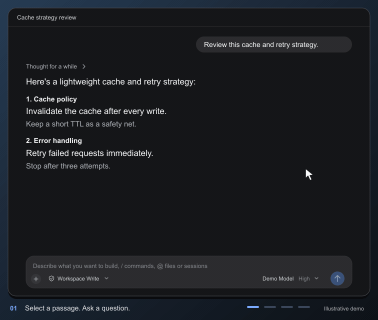

# In-place Annotate for DSH

[English](README.md) | **简体中文**

在 DSH Web 对话中，选中 agent 回复里的一句话，即可直接标记为 **同意**、**不同意**、**疑问** 或 **批注**。批注会暂存在当前会话中，发送下一条 prompt 时自动附带。

- 适合审阅长回复：边读边标，最后一次性反馈。
- 每条批注都附带你选中的原文，agent 能准确知道你在说哪一段。
- 已批注的原文会加上荧光笔式的高亮；点击待发送列表中的条目，即可跳回原文。

## 目录

- [In-place Annotate for DSH](#in-place-annotate-for-dsh)
  - [目录](#目录)
  - [环境要求](#环境要求)
  - [安装与启用](#安装与启用)
  - [快速上手](#快速上手)
  - [操作说明](#操作说明)
  - [卸载](#卸载)
  - [许可证](#许可证)

## 环境要求

- 使用 DSH **Web GUI**（运行 `dsh web` 后打开的页面）。本插件的界面仅支持 Web 端。
- 当前 profile 已安装并启用本插件（包名 `@local/dsh-inplace-annotate`）。
- 浏览器能正常访问 DSH 页面，且你已登录。

## 安装与启用

本插件通过 DSH 的 Plugin Manager 以本地 bundle 形式安装，在插件列表中显示为 **回复批注** 或 **Reply annotations**，具体取决于界面语言；包名为 `@local/dsh-inplace-annotate`。

首次安装：

1. 在 DSH 的 Plugin Manager 中，将本插件目录作为本地 bundle 安装。如果你正在使用 DSH agent，也可以让它对该目录执行 **Install bundle**。
2. 确认 `@local/dsh-inplace-annotate` 已出现在插件列表中，并处于启用状态。
3. **刷新当前 DSH 页面。** 客户端代码在页面加载时注入，安装后需要刷新页面，才能看到新界面。
4. 如果 Plugin Manager 提示需要重启，按提示重启对应的 profile，再重新打开页面。

修改插件代码后，需要重新加载插件并刷新页面；只修改文件，不会替换页面中已经加载的客户端代码。

## 快速上手

1. 等一条 agent 回复**完成**（流式输出结束）。
2. 用鼠标选中回复里的一句话或一个短语。
3. 选区上方会出现操作条：**同意 / 不同意 / 疑问 / 批注 / 引用**。
4. 点击「同意」「不同意」或「疑问」会立即保存批注。点击「批注」会打开输入框，写好备注后按 `Cmd/Ctrl+Enter` 保存。保存后，原文会高亮显示。
5. 消息输入框上方会出现「待发送批注」栏（英文界面为 **Review notes**），列出你已添加的批注。点击条目的原文区域或右侧箭头，可以跳回对应位置。
6. 照常输入并发送下一条 prompt。批注会随这条 prompt 一起交给 agent；你的消息气泡只显示自己输入的文字。
7. agent 开始处理这条 prompt 后，待发送批注栏会自动清空。

## 操作说明

| 操作 | 作用 | 保存后 |
|---|---|---|
| **同意** | 你认可所选原文 | 记录原文，不要求 agent 修改 |
| **不同意** | 你不认可所选原文 | 记录原文，agent 应修改或重新考虑这部分内容 |
| **疑问** | 你对所选原文有疑问，希望 agent 进一步解释 | 立即记录原文，无需填写备注 |
| **批注** | 输入具体反馈 | 记录原文和你的备注；备注可以后续编辑 |
| **引用** | 将所选原文插入输入框（DSH 原有的引用功能） | 不产生批注，只将原文插入输入框 |
| **跳转** | 点击待发送批注栏中的条目 | 滚动到对应原文，并短暂高亮显示 |

## 卸载

1. 在 Plugin Manager 中停用或移除 `@local/dsh-inplace-annotate`。
2. 刷新 DSH 页面。
3. 卸载时，Host 会清理尚未发送的批注；已发送的批注会保留在会话历史中。

如果只想临时关闭，可以在该 profile 的 `cordis.patch.yml` 中，将 `inplace-annotate` 这一行设为 `disabled: true`。

## 许可证

本项目采用 [MIT License](LICENSE) 许可。
